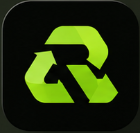

# Rejet Corp



**Marketplace B2B para o reaproveitamento de excedentes industriais.**

Empresas podem publicar materiais, encontrar fornecedores, negociar e acompanhar sua operação no Dashboard e em Relatórios.

[Como iniciar](#como-iniciar) · [Login e dados com Supabase](#login-e-dados-com-supabase) · [Problemas comuns](#problemas-comuns)

## Como iniciar

### 1. Instale os pré-requisitos

Instale o [Node.js 24](https://nodejs.org/en/download) e o [Git para Windows](https://git-scm.com/download/win). O Node.js inclui o npm. Abra um novo PowerShell e confira as versões.

```powershell
node --version
npm.cmd --version
git --version
```

### 2. Baixe o projeto

```powershell
git clone https://github.com/Leotzt1st/Rejet-Corp.git
cd Rejet-Corp
```

Se você baixou o ZIP, extraia o arquivo e abra o terminal na pasta que contém `package.json`.

### 3. Instale as dependências

```powershell
npm.cmd ci
```

### 4. Inicie o site

```powershell
npm.cmd run dev
```

Abra o endereço que o Vite mostrar no terminal. O padrão é [http://localhost:5173](http://localhost:5173/). Mantenha o terminal aberto enquanto usa o site. Pressione **Ctrl+C** para encerrar.

**Sem Supabase**, você pode navegar pela página inicial e pela página de informações. Login, cadastro e as telas com dados da empresa ficam indisponíveis.

## Login e dados com Supabase

1. Use um projeto Supabase de teste. Para um banco novo, carregue o [schema base](supabase/schema.sql) pelo SQL Editor. Confira as migrações adicionais e a ordem de aplicação na [arquitetura](docs/architecture.md). Se o banco já existir, confira quais versões foram aplicadas.
2. No painel do projeto, copie a URL e a chave publicável. Veja como encontrá-las na [documentação de chaves do Supabase](https://supabase.com/docs/guides/api/api-keys).
3. Na pasta de `package.json`, crie o arquivo `.env.local`. Cole as linhas abaixo **no arquivo** e substitua os exemplos pelos valores do seu projeto.

   ```dotenv
   VITE_SUPABASE_URL=https://seu-projeto-de-teste.supabase.co
   VITE_SUPABASE_ANON_KEY=sua-chave-publicavel
   ```

   Use a chave **Publishable** ou a chave pública legada **anon**. Guarde a chave de serviço e as chaves secretas no servidor. O Git ignora `.env.local`.

4. Reinicie com `npm.cmd run dev`. Abra o site, clique em **Cadastre sua empresa** e use dados fictícios. Se o Supabase pedir confirmação de e-mail, confirme antes de entrar.

## Problemas comuns

| Sintoma | O que fazer |
| --- | --- |
| O PowerShell bloqueia `npm.ps1`. | Use `npm.cmd` nos comandos deste guia. |
| O terminal tenta executar `VITE_SUPABASE_URL=...`. | Salve as variáveis em `.env.local` e reinicie o servidor. |
| O login continua desabilitado. | Confira o nome do arquivo, as duas variáveis e se o Vite reiniciou. |
| O endereço local não abre. | Veja o endereço exato no terminal. Se a porta padrão estiver ocupada, o Vite pode escolher outra. |

## Validação e documentação

Execute `npm.cmd run check` para conferir o lint, os tipos e o build.

- [Produto e fluxos](PRODUCT.md)
- [Desenvolvimento local](docs/onboarding.md)
- [Arquitetura e migrações](docs/architecture.md)
- [Financeiro e ambiente de teste](docs/finance.md)
- [Sistema visual](DESIGN.md)
- [Qualidade e testes](docs/quality.md)
- [Configuração do Toolkit](docs/setup.md)
